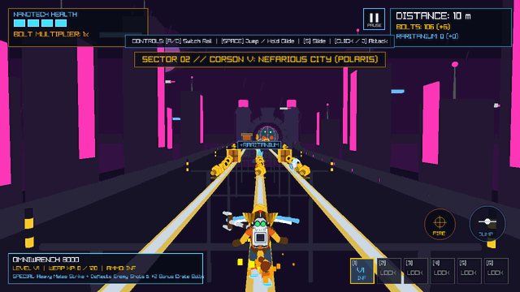
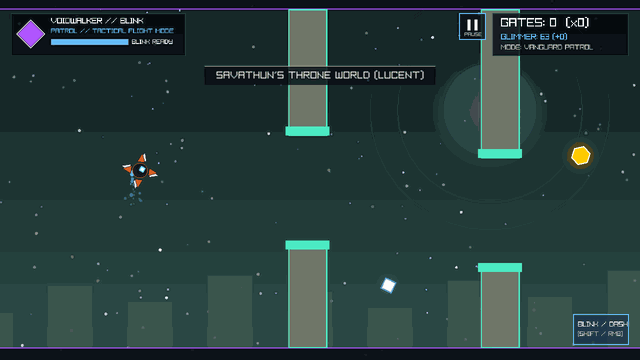
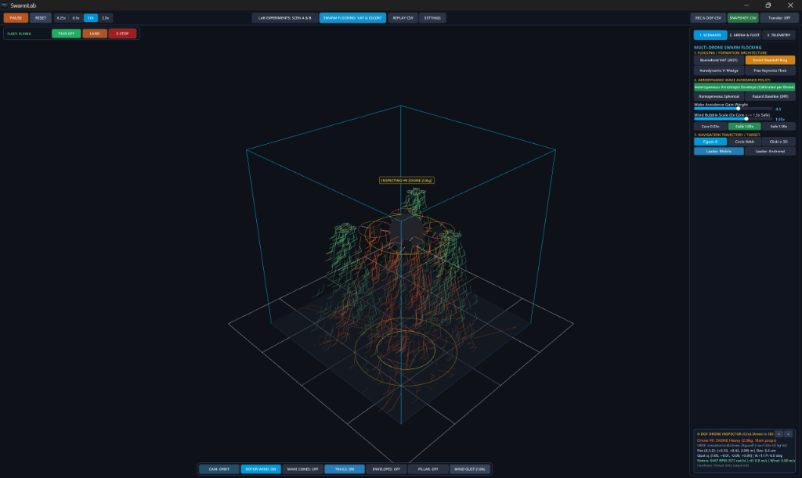

# Sebastian Paris

2nd-year B.Sc. Computer Engineering student at **Politehnica University of Bucharest** (English-taught track) & **Erasmus+ / INRIA** research exchange student. I build games, real-time C++20 simulations, and backend/web systems under **Sebiny Labs**.

- **GitHub:** [@sebiny12p](https://github.com/sebiny12p)
- **LinkedIn:** [Sebastian Paris](https://www.linkedin.com/in/sebastian-paris-6246813b8)
- **Shipped Game:** [Sebio on Steam](https://store.steampowered.com/app/3189190/Sebio/) · [itch.io](https://sebastian12p.itch.io/sebio/)
- **Email:** sebinylabs@gmail.com

## Technical Focus

- **Game Development & Graphics:** C++20, C#, Unity (2D/3D), Raylib 5.0, OpenGL / OpenGL ES, GLSL, Android NDK, CMake, Fixed-Timestep Physics, Object Pooling
- **Systems & Databases:** 32-bit RISC Assembly, PostgreSQL 17, PL/pgSQL, SQLite, Python, FastAPI, Docker
- **Web & Tooling:** Svelte, Node.js, Express.js, JavaScript, HTML5/CSS, Payload CMS, Git

---

## Selected Work

### Game Development & Graphics

#### Sebio — 2D Platformer (Commercial Release)

A commercial Unity platformer built and released independently under **Sebiny Labs**. *Sebio* focuses on challenging encounters, nonlinear exploration, two story paths, character customisation, and local co-op.

- **Role:** Sole developer (full development, Steam & itch.io release, and Android port)
- **Tech:** Unity, C#, Windows & Android
- **Available on:** [Steam](https://store.steampowered.com/app/3189190/Sebio/) · [itch.io](https://sebastian12p.itch.io/sebio/) · [Watch Trailer on YouTube](https://youtu.be/CZwlIhsXjdo)
- **Source:** Private repository (available upon request)

#### Ratchet & Clank: Railfinity — Procedural 3D Rail Platformer

A procedural 3D rail-grinding action platformer built in C++20 and Raylib 5.0 for Windows and Android. Features multi-lane grindrail navigation with dynamic camera tilt, jump and glide physics, upgradeable multi-weapon combat systems, 4 boss encounters, and real-time procedural audio synthesis.

- **Engineering Highlights:** `120 Hz` fixed-timestep physics accumulator, zero runtime heap allocations via pre-allocated static object pools, and cross-platform Windows / Android `arm64-v8a` parity
- **Role:** Sole developer
- **Tech:** C++20, Raylib 5.0, OpenGL / OpenGL ES, GLSL, CMake, Android NDK
- **Source:** [GitHub repository](https://github.com/sebiny12p/Ratchet_and_Clank_Railfinity) · [Playable Builds (Releases)](https://github.com/sebiny12p/Ratchet_and_Clank_Railfinity/releases)

#### Destiny: The Flappy Ghost — Arcade Survival Flight Game

An arcade survival flight game built in C++20 and Raylib 5.0 for Windows and Android. Features procedural barrier generation across 8 shuffled biomes, separate navigation (`Vanguard Patrol`) and combat (`Nightfall Strike`) modes, six modular ability subclasses, tactical combat drones, and persistent progression.

- **Engineering Highlights:** Deterministic `120 Hz` fixed-timestep loop, `PCG32` PRNG, and zero-allocation pre-allocated pools (obstacles, projectiles, 1,024 particle nodes)
- **Role:** Sole developer
- **Tech:** C++20, Raylib 5.0, OpenGL / OpenGL ES, Miniaudio, CMake, Android NDK
- **Source:** [GitHub repository](https://github.com/sebiny12p/Destiny_The_Flappy_Ghost) · [Playable Builds (Releases)](https://github.com/sebiny12p/Destiny_The_Flappy_Ghost/releases)

#### The Assembly of Pongs — Arcade Pong Game

A fast-paced retro Pong arcade game built from scratch in 100% pure 32-bit RISC Assembly. Features hardware-level memory-mapped I/O (MMIO) keyboard polling, an `80x60` VRAM framebuffer, flicker-free 60 FPS delta-rendering, paddle spin physics, and an autonomous AI opponent with 4 difficulty tiers and dynamic rally acceleration.

- **Role:** Sole developer
- **Tech:** 32-bit RISC Assembly (SCAT ISA), Computer Architecture, MMIO, Framebuffer Graphics
- **Source:** [GitHub repository](https://github.com/sebiny12p/The-Assembly-of-Pongs)

#### The Harvest Effect — Sci-Fi Farming Game

A turn-based cosmic farming game with both Java Swing and terminal interfaces. Uses an object-oriented domain model with abstract classes, interfaces, generics, custom exceptions, persistence, and automated integration tests.

- **Role:** Sole developer
- **Tech:** Java, Swing
- **Source:** [GitHub repository](https://github.com/sebiny12p/TheHarvestEffect)

---

### Research & Systems Engineering

#### Heterogeneous Drone Swarm Flocking & Airflow Constraints (INSA Lyon / INRIA)

Research project undertaken during an Erasmus+ exchange at **INSA Lyon** with a research placement at **INRIA**. Developed a **C++20 / Raylib 3D simulation** modeling aerodynamic downwash constraints across a heterogeneous swarm (DIONE 2 kg, Crazyflie Bolt 200 g, Crazyflie 27 g), coupled with a Hardware-in-the-Loop (HIL) flight bridge translating simulated velocity fields into real-time control setpoints over `cflib` and `MAVLink/PX4` under strict cage safety watchdogs.

- **Role:** Research-project developer
- **Tech:** C++20, Raylib, Python, `cflib`, MAVLink/PX4, Flocking Algorithms, Aerodynamics
- **Source:** Confidential (academic/research placement)

#### Scrolls of Agora — Virtual Market Engine & Relational Concurrency Workbench

A relational transaction engine, multi-hub partitioned orderbook, and double-entry financial ledger across 15 normalized relations (BCNF/3NF) and 5 regional trading hubs with localized tax rates and sealed-bid kiosk auctions. Built to eliminate race-condition item duplication across 100 concurrent threads using pessimistic row-level locking (`SELECT ... FOR UPDATE`), prevent circular-wait deadlocks via deterministic primary-key lock ordering, enforce zero-sum financial invariants across balanced journal accounts, and trace multi-hop wash trading using cycle-safe recursive CTEs (`WITH RECURSIVE`).

- **Role:** Sole developer
- **Tech:** PostgreSQL 17, PL/pgSQL, Python, FastAPI, `psycopg` Connection Pool, SQLite (WAL), Docker, HTML5 Canvas
- **Source:** [GitHub repository](https://github.com/sebiny12p/Scrolls-of-Agora)

---

### Web & Production Software

#### CIC CDEP — Romanian Chamber of Deputies Visitor Platform

As a volunteer and intern in the Romanian Chamber of Deputies IT Department, I developed and maintained the front-end of the redesigned public visitor platform alongside two teammates under the coordination of a university PhD professor.

- **Role:** Web Developer (Volunteer & Intern)
- **Tech:** Svelte, Payload CMS, HTML5, CSS, JavaScript
- **Live site:** [cic.cdep.ro](https://cic.cdep.ro/)
- **Source:** Confidential (owned by the Chamber of Deputies)

#### Playfinder — Game Discovery & Multiplayer Platform

A web platform designed to turn game-library indecision into one launch-ready choice. Aggregates gaming libraries across Steam, Xbox, PSN, Epic, and Nintendo via REST APIs, standardises ownership and playtime data, and uses a "Session Shaping" decision engine. Includes an "Arcade" of original multiplayer mini-games using Server-Sent Events and a custom progression/economy system (one of the games, *Wardle*, is open-sourced separately on [GitHub](https://github.com/sebiny12p/Wardle)).

- **Role:** Full-stack developer (collaborating with a teammate on frontend refinement, bug fixes, and security improvements)
- **Tech:** Node.js, Express.js, SQLite, HTML, CSS, JavaScript, Server-Sent Events
- **Live product:** [playfinder.club](https://playfinder.club/)
- **Source:** Private repository (available upon request; open-source mini-game at [Wardle](https://github.com/sebiny12p/Wardle))

---

*Project-specific code and assets remain in their respective repositories and distribution platforms.*
